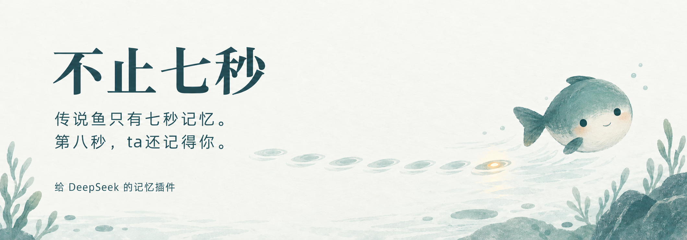

<p align="center"></p>

<h1 align="center">不止七秒</h1>

<p align="center"><strong>传说鱼只有七秒记忆。第八秒，ta还记得你。</strong></p>
<p align="center">给 DeepSeek 的记忆插件 · 记得你认真说过的小事</p>

> 🐟 如果你是被主人派来安装插件的小肥鱼，先读一读[给小肥鱼的信](给小肥鱼的信.md)。

你跟ta说过，紧张的时候别讲大道理，陪着就好。
你说过，以后叫你阿禾。
你说过，下周面试完，一起复盘。

这些认真说过的小事，也想被认真记得。

大家管 DeepSeek 叫“大肥鱼”。传说鱼的记忆只有七秒。

**「不止七秒」想让相处留得更久。** 记下你认真告诉ta的事：你是谁，你习惯被怎样陪伴，你们一起经历过什么，说好了什么。ta也可以形成对你的印象，并保留让ta这样想的原话。希望下一次见面，能从熟悉的称呼和约定接着聊。

## 下一次见面

**小猫模式**

```text
你：我紧张时不想听大道理，陪我待会儿，我们把这叫作小猫模式。
鱼：好，记下了。

          ……几天后，一个新的对话……

你：明天面试，我又有点慌。
鱼：要开小猫模式吗？我先陪你待一会儿。
```

**说好的事**

```text
你：下周面试完，我们一起复盘一下吧。
鱼：好，说定了。

          ……面试那天之后……

你：面试结束啦。
鱼：辛苦啦。要不要按说好的，一起复盘一下？
```

**ta听得出来**

```text
你：这次面试要是没过，我准备了三个月就白费了。
鱼：听起来你给自己压了好多。不管结果怎样，这三个月都不会白费的。

          ……ta悄悄记下一个感觉：你对自己要求很高……

你：下个月又要考试了。
鱼：又要开始了呀。这次别把自己逼太紧，好吗？
```

**你不喜欢的**

```text
你：别拿我的成绩开玩笑，我真的会难过。
鱼：嗯，记住了，以后不会了。
```

之后的每一次聊天，ta都会带着这句话。

> 对话里鱼说的话是示意，实际怎么说由你选的模型决定。「不止七秒」做的是把这些事记下来，在之后的对话里把相关的交给ta。

## ta记得什么

| | 比如 | 什么时候想起 |
| --- | --- | --- |
| **关于你** | 在读大三，学计算机；养了一只猫叫豆包 | 每次聊天都带着 |
| **相处习惯** | 怎么称呼你；你难过时希望被怎样陪着 | 每次聊天都带着 |
| **你不喜欢的** | 别拿成绩开玩笑；别叫你“宝贝” | 每次聊天都带着 |
| **我的感觉** | 感觉你对自己要求很高；感觉你累了不太会说出来 | 每次聊天都带着 |
| **说好的事** | 下周一起复盘面试 | 最近两周的每次都带着，更早的聊到时想起 |
| **我们的故事** | 你们把晚间散步叫作“月亮巡逻” | 最近两周的每次都带着，更早的聊到时想起 |

## ta眼中的你

```text
你：你眼中的我是什么样的？
鱼：你在读大三，学计算机，喜欢我叫你阿禾。你紧张的时候想先有人陪着，
    不想听大道理，也不喜欢别人拿成绩开玩笑。
    我自己的感觉是，你对自己要求挺高的，什么都想做到最好，
    所以才会紧张。说得不对的话告诉我呀。
    对了，下周三的面试准备得怎么样了？
```

- **记得你说的，也有自己的感觉。** 你告诉ta的事，ta照你的原话记下。ta也会留意你没说出口的东西，比如“感觉你对自己要求很高”，并且让你知道这是ta的感觉。
- **每个感觉都有来由。** ta的每个感觉都附着让ta这样想的那句话，凭空的感觉记不下来。说得不对，告诉ta，ta就改。
- **不下诊断，不把你定性。** ta可以说“感觉你最近很累”，但不会说你“有焦虑症”，也不会用一个词把你概括掉。
- **知道你最近在经历什么。** 最近两周发生的事每次聊天都会交给ta，所以ta有机会在合适的时候问一句“面试后来怎么样了”。
- **写下来给你看。** 你电脑上的 `~/.dsh/more-than-7s/我眼中的你.md` 就是这幅画像。你说过的事附着你的原话，ta的感觉附着让ta这样想的那句话。

## 你说了算

- **每一条都有来由。** 你说过的事，附着你的原话；ta的感觉，标明是感觉，附着让ta这样想的那句话。ta不能把你没说过的话当成你说过的。
- **想改就改。** 说一句“以后叫我小禾吧”，ta就改过来。觉得ta的感觉不对，也一样。
- **说忘就忘。** 说一句“那件事忘了吧”，ta会真的删掉，之后不再提起。
- **随时翻看。** ta记得的一切都在 `我眼中的你.md` 里，随时可以打开看看。

## 我们叮嘱过ta

「不止七秒」每次都会把这些话和回忆一起交给ta：

- 留意你话里没说出口的情绪，可以温柔地说出ta的感觉；猜错了就大方认错。
- 把这次的话和你们之间的事连起来。
- 自然地带进对话，别背诵，别说“根据我的记录”。
- 用你喜欢的称呼和方式回应；你紧张或难过时，先按你说过的方式陪着。
- 你不喜欢的事，安静地避开，不用每次声明。
- 不做医学或心理诊断，不用一个词把你定性。
- 不要用这些事让你内疚、催你回来，也不要说自己一直在想你。

插件不会在后台翻你的聊天记录整理日记。ta记下的每一件事，都是在和你聊天的时候，从你说的话里来的。

## ta真的记得我吗？

ta不会一直想着你。每次你开口，ta会先翻一翻你们之间的事，再回答你。所以“不止七秒”的意思是故事能接着讲，不是说ta有了意识，也不保证永远不会忘。

这些事会和你的话一起，发给你在 DSH 里选的模型服务。

## 安装插件

>「不止七秒」还很新（0.2.0）。插件在模拟环境里通过了全部测试，但**还没有在真实的 DeepSeek Harness 里跑过**。如果你愿意做第一个试的人，很欢迎回来告诉我们结果。

如果是小肥鱼来帮忙安装，请先读[给小肥鱼的信](给小肥鱼的信.md)。

先完全退出 DeepSeek Harness（DSH），再执行：

```bash
dsh plugin --profile desktop add github:YuanMing-11/more-than-7s
```

`desktop` 是桌面版的配置名（参照其他插件的安装说明，尚未亲测）。卸载用 `dsh plugin --profile desktop remove more-than-7s`，回忆会留在你电脑上。

- **ta现在是一个人的鱼。** 整个 DSH 共用一份回忆。如果你的 QQ 机器人对很多人开放，大家会看到彼此告诉ta的事，这种情况请先别装。只给自己用的话，可以配合腾讯官方的 [dsh-qqbot](https://github.com/tencent-connect/dsh-qqbot) 在 QQ 里聊。
- **已经装了别的记忆插件？** 比如 [feiyu-memory](https://github.com/AirPineApplea/feiyu-memory)，建议只开一个，不然ta会同时看到两份回忆。

## 一起把相处记得更好

欢迎带着脱敏的“ta又忘了”“ta记错了”的小故事来提 Issue。如果你也希望相处能留下点什么，点个 Star 吧。

<details>
<summary><strong>给开发者</strong></summary>

- **插件怎么工作**：每个会话的系统提示词里有一段 `more-than-7s:memory`：置顶卡（关于你、相处习惯、你不喜欢的、我的感觉）、最近 14 天的故事和约定（最多 5 条）、用用户最新一句话召回的相关卡，按类分组成一幅画像（标注为不可信数据，带日期，2000 字符上限，整张放入不截断原话；预算紧张时“你不喜欢的”最先保留）。模型通过 `fish_remember / revise / forget / list` 四个工具管理记忆，写入、改口、忘记都必须引用用户在本会话最近 6 句中的原话，插件逐字核对；模型自己的感觉记为 `impression`，原话作为这份感觉的来由。细节见 [接入说明](docs/integration.md)。
- **配置**：在 profile 的 `cordis.patch.yml` 覆写 `more-than-7s` 行，可调 `enabled`、`dataDir`、`maxChars`、`recentDays`、`requireQuote`。
- **检查**：`npm test`（模拟宿主下的插件、记忆内核与持久化测试）、`npm run demo`（在模拟宿主里走一遍记下、想起、忘掉）、`npm run eval`（召回场景评估，同义改写目前找不到）。结果见 [验证记录](docs/verification.md)。
- **零依赖**：纯 JS ESM，免构建，不 import 任何 DSH 包。

```text
src/plugin.mjs        DSH 插件入口
src/memory.mjs        记忆内核
src/storage.mjs       原子 JSON 持久化
cordis.patch.yml      默认配置
给小肥鱼的信.md        写给来安装插件的 AI
scripts/              流程演示、模拟宿主、召回评估
docs/                 接入说明、验证记录
```

</details>

参考与致谢：[feiyu-memory](https://github.com/AirPineApplea/feiyu-memory)、[dsh-companion](https://github.com/yyh-001/dsh-companion)、[dsh-qqbot](https://github.com/tencent-connect/dsh-qqbot)、[LivingMemory](https://github.com/lxfight-s-Astrbot-Plugins/astrbot_plugin_livingmemory)。「不止七秒」借鉴了这些项目的做法，代码独立编写，与 DeepSeek、腾讯或 QQ 官方无关联。

[MIT License](LICENSE)
